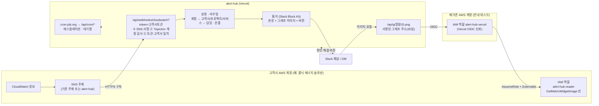
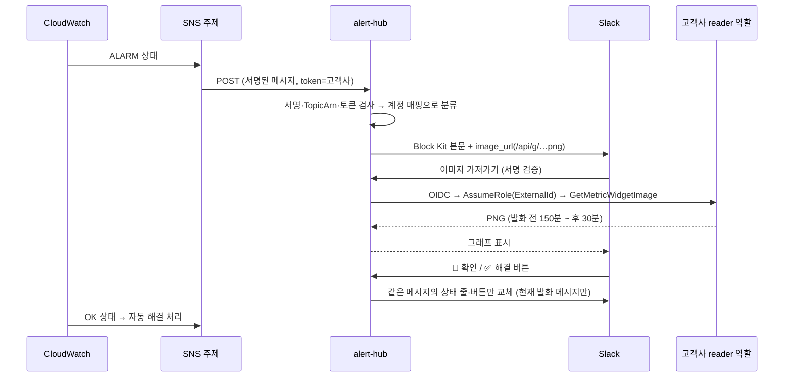
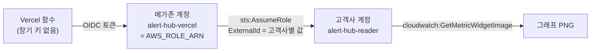
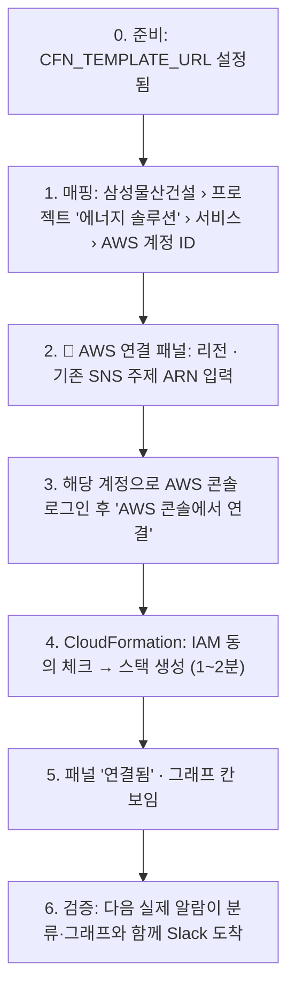
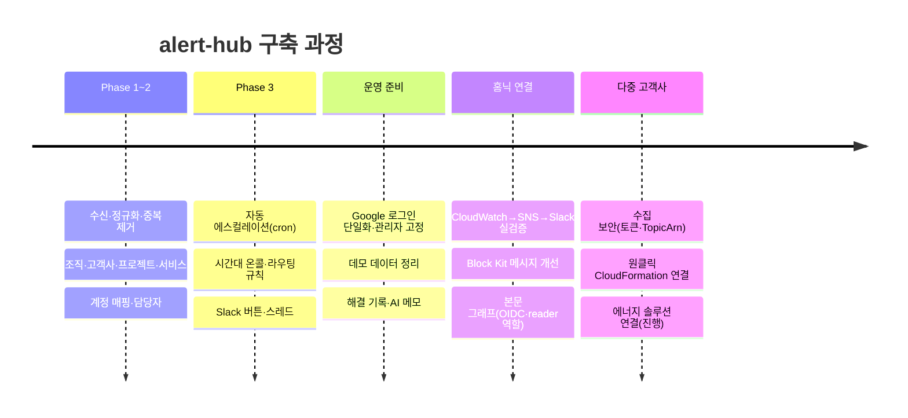

# alert-hub 연결 가이드 — 전체 흐름과 고객사 AWS 계정 연결 (2026-11-06)

지금까지 만든 것을 한 장에 정리하고, 새 AWS 계정(예: 홈닉 **에너지 솔루션**)을 붙이는 절차를 단계별로 적는다.

---

## 1. 전체 그림

| 구성 | 하는 일 | 어디서 설정 |
|---|---|---|
| CloudWatch → SNS | 경보 상태 변화를 SNS 로 발행 | 고객사 계정 |
| SNS HTTPS 구독 | alert-hub 수신 주소(고객사 전용 토큰 포함)로 전달 | CloudFormation 이 자동 생성 |
| 수집 검사 | 서명 · 주제 계정 · 토큰 일치. 거부는 "최근 거부"에 기록 | 코드(`src/server/ingest-guard.ts`) |
| 분류 | 계정 ID → 고객사/프로젝트/서비스, 담당자 상속 | 화면: 고객사 › 계정 매핑 |
| Slack 통지 | 헤더·수치·스파크라인·그래프 이미지·버튼·"alert-hub 에서 열기" | Slack 앱 + 채널 설정 |
| 그래프 | Vercel → 안내 데스크 역할 → 고객사 reader 역할 → 그래프 PNG | `AWS_ROLE_ARN` + 고객사별 연결 |
| 크론 | 에스컬레이션, 대기열 처리 | cron-job.org (Authorization 헤더) |

## 2. 알람 하나가 지나가는 순서

그래프는 실패해도 통지를 막지 않는다. Slack 이 이미지를 거절하면 그래프 블록 없이 다시 보낸다.

## 3. 권한 사슬 (왜 역할이 두 개인가)

- `alert-hub-vercel` (메가존, 한 번만): alert-hub 의 신원. 고객사가 몇 개든 하나.
- `alert-hub-reader` (고객사 계정마다): 그래프 한 장 읽는 권한만. **ExternalId** 가 맞아야만 빌릴 수 있어 다른 고객사 것으로 위장 불가.
- 비용: 지표 1,000개당 약 $0.02, **고객사 계정**에 청구(알람 1건 ≈ 지표 1~2개).

## 4. 한 번만 하는 준비 (이미 한 것 ✅ / 남은 것 ⬜)

| | 항목 | 비고 |
|---|---|---|
| ✅ | Vercel 배포 · Neon DB · Google 로그인 | `jsmini3814@gmail.com` 항상 관리자 |
| ✅ | Slack 앱 (봇 토큰, `SLACK_SIGNING_SECRET`, Interactivity URL `/api/slack/…`) | 버튼 동작 확인 |
| ✅ | cron-job.org → `/api/cron/*` (`Authorization: Bearer CRON_SECRET`) | |
| ✅ | 메가존 계정 `alert-hub-vercel` 역할 + Vercel `AWS_ROLE_ARN`, `AWS_REGION` | OIDC |
| ✅ | `APP_URL` (없으면 `VERCEL_PROJECT_PRODUCTION_URL` 사용) | "열기" 버튼·그래프 주소 |
| ⬜ | **템플릿 S3 업로드 + `CFN_TEMPLATE_URL`** | 원클릭 연결에 필요(아래) |
| ⬜ | 노출된 Slack·DB 비밀값 재발급 | 테스트 끝나고 |

### 템플릿 S3 업로드 (원클릭의 전제, 한 번)
CloudFormation 빠른 생성 링크는 템플릿이 **S3 주소**여야 한다.
1. 메가존 계정 S3 › 버킷 만들기 (예: `alert-hub-cfn-<임의>`, 리전 ap-northeast-2).
2. `https://alert-hub-rho.vercel.app/cfn/alert-hub-connect.yaml` 을 내려받아 버킷에 업로드.
3. 그 객체만 공개 읽기 (버킷 정책 `s3:GetObject` on `arn:aws:s3:::버킷/alert-hub-connect.yaml`).
4. Vercel › Settings › Environment Variables 에 `CFN_TEMPLATE_URL=https://버킷.s3.ap-northeast-2.amazonaws.com/alert-hub-connect.yaml` → 재배포.
5. 계정 매핑 패널에서 "아직 준비 안 됨: CFN_TEMPLATE_URL" 문구가 사라지면 완료.

## 5. 새 계정 연결 — 홈닉 에너지 솔루션 예시

### 1) 계정 매핑 (alert-hub 화면)
1. **등록 관리 › 고객사 › 삼성물산건설** 진입.
2. 프로젝트 **에너지 솔루션** 추가(별도 프로젝트로 두면 담당·채널을 나눠 줄 수 있음).
3. 그 아래 서비스 추가(예: `energy-prd`).
4. **AWS 계정 매핑**에 에너지 솔루션 계정 ID(12자리) 입력 → 저장. 담당자는 프로젝트에서 상속.
5. Slack 채널을 다르게 받고 싶으면 프로젝트 통지 채널 지정, 아니면 고객사 채널 그대로.

### 2) AWS 연결 (원클릭)
1. 매핑 줄 아래 **🔗 AWS 연결 (알람 수신 · 그래프)** 펼치기.
2. **리전**: 경보가 있는 리전(대부분 `ap-northeast-2`). 리전이 여러 개면 리전마다 한 번씩.
3. **지금 쓰는 SNS 주제 ARN**: 경보가 이미 알림을 보내는 주제를 넣는다
   (CloudWatch › 경보 › 해당 경보 › 작업 › 알림 대상에서 확인, `arn:aws:sns:ap-northeast-2:<계정>:<이름>`).
   → 그 주제에 **구독만 추가**되고 경보는 하나도 바뀌지 않는다. 기존 수신자(이메일·247 등)도 그대로.
   - 비우면 새 주제 `alert-hub` 를 만든다. 이때는 경보 알림 대상에 그 주제를 직접 추가해야 알람이 온다.
4. **그래프 역할도 만들기** 체크 유지.
5. 다른 탭에서 **에너지 솔루션 계정으로 AWS 콘솔 로그인**(스위치 롤 가능) → **AWS 콘솔에서 연결** 클릭.
6. CloudFormation 빠른 생성 화면 — 스택 이름 `alert-hub-connect`, 파라미터는 이미 채워져 있음.
   맨 아래 **"AWS CloudFormation에서 IAM 리소스를 생성할 수 있음을 승인합니다"** 체크 → **스택 생성**.
7. 상태가 `CREATE_COMPLETE` 가 되면(1~2분) alert-hub 패널 새로고침 → **연결됨 · 시각 확인**, 빈 그래프 칸이 보이면 성공.

스택이 만드는 것:

| 리소스 | 내용 |
|---|---|
| SNS 구독 | 기존(또는 새) 주제 → `…/api/webhooks/cloudwatch?token=<고객사 토큰>` (HTTPS). alert-hub 가 확인 요청을 자동 수락 |
| IAM 역할 `alert-hub-reader` | 신뢰: 메가존 `alert-hub-vercel` + ExternalId. 권한: `cloudwatch:GetMetricWidgetImage` 만 |

### 3) 검증
- **고객사 페이지 › 수신 주소** 영역에 "최근 거부"가 없어야 한다(있으면 사유 확인, 아래 표).
- 일부러 경보를 울리지 말 것(247 호출). 다음 자연 발생 알람을 기다리거나, 영향 없는 **테스트 경보**를 별도 주제가 아닌 같은 주제에 낮은 임계치로 만들었다가 바로 지운다.
- Slack 메시지: 헤더에 고객사/서비스가 맞게 나오고, 본문에 그래프, 버튼 동작, "alert-hub 에서 열기".
- alert-hub 알람 상세: 그래프가 없으면 상세 화면에 이유가 그대로 표시된다.

### 4) 철회 (되돌리기)
- CloudFormation › 스택 `alert-hub-connect` **삭제** → 구독과 역할이 함께 사라진다. 기존 주제·경보는 그대로.
- alert-hub 쪽은 계정 매핑 삭제(또는 그대로 두면 미매핑 알람만 안 옴).
- 토큰이 샜다고 의심되면 고객사 페이지에서 수신 토큰 **재발급** → 스택 업데이트(파라미터 IngestUrl 교체).

### 5) 문제 해결

| 증상 | 원인 | 조치 |
|---|---|---|
| 패널에 "아직 준비 안 됨: CFN_TEMPLATE_URL" | S3 템플릿 미설정 | §4 준비 |
| CloudFormation "S3 error / Access denied" | 템플릿 객체가 공개 읽기가 아님 | 버킷 정책 확인 |
| 스택 실패: 주제를 찾을 수 없음 | 주제 ARN 의 계정·리전이 로그인 계정과 다름 | 같은 계정·리전으로 로그인 |
| 스택 실패: Role already exists | 이 계정에 `alert-hub-reader` 가 이미 있음 | "그래프 역할도 만들기" 끄고 재실행 |
| 패널 "연결 안 됨 · AccessDenied" | ExternalId 불일치 / 스택 생성 직후 전파 지연 | 1~2분 뒤 "다시 확인", 계속이면 스택 재생성 |
| 알람이 안 옴 | 구독 미확인, 또는 경보 알림 대상에 그 주제가 없음 | SNS › 구독 상태 `Confirmed` 확인, 경보 작업 확인 |
| "최근 거부: 주제 계정 불일치" | 다른 계정 주제에서 옴 | 그 계정도 같은 고객사에 매핑 |
| "최근 거부: 토큰-고객사 불일치" | 다른 고객사 토큰 URL 로 구독 | 올바른 고객사 패널에서 다시 연결 |
| Slack 에 그래프만 없음 | reader 미연결 / 수식 전용 경보 | 알람 상세의 그래프 사유 확인 |

## 6. 지금까지의 과정 (요약 연표)

## 7. 다음 할 일
- ⬜ 템플릿 S3 업로드 + `CFN_TEMPLATE_URL` → 에너지 솔루션 연결.
- ⬜ 홈닉 기존 계정도 전용 토큰 URL 로 구독 교체 후 전역 `INGEST_TOKEN` 제거.
- ⬜ 계정 안 서비스 분류(이름·리소스 패턴), 고객사별 심각도·에스컬레이션 시간 (`docs/multi-tenant-plan.md` 3-2, 3-5).
- ⬜ 비밀값 재발급.

관련 문서: [다중 고객사 계획](multi-tenant-plan.md) · [출시 체크리스트](launch-checklist.md)
